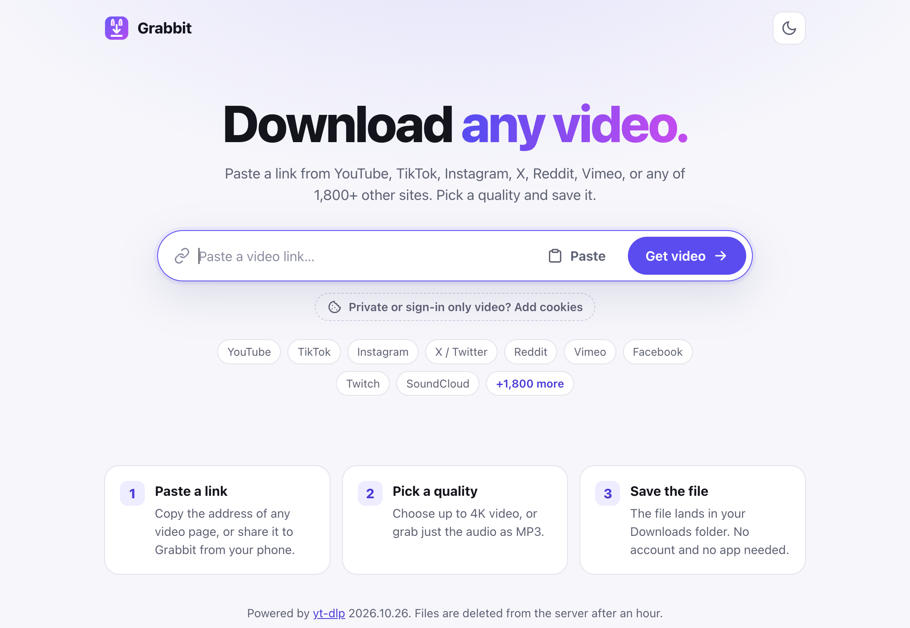
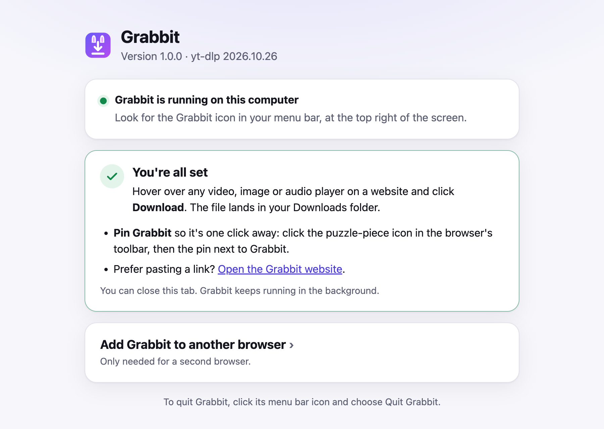

<p align="center">
  
</p>

<h1 align="center">Grabbit</h1>

<p align="center">
  Download videos, audio and images from any website: YouTube, Instagram, X, TikTok, Reddit, Facebook, Vimeo and
  <a href="https://github.com/yt-dlp/yt-dlp/blob/master/supportedsites.md">1,800+ more</a>.
</p>

<p align="center">
  <a href="https://github.com/naved1197/grabbit/releases/latest"><b>Download for Mac and Windows</b></a>
  &nbsp;·&nbsp; <a href="#how-it-works">How it works</a>
  &nbsp;·&nbsp; Made by <a href="https://cubehole.com">Cubehole</a>
</p>

<p align="center">
  <a href="https://github.com/naved1197/grabbit/releases/latest"></a>
  <a href="https://github.com/naved1197/grabbit/actions/workflows/desktop.yml?query=branch%3Amain"></a>
  <a href="LICENSE"></a>
</p>

Install the Grabbit app, add the browser extension once, and every video, image and audio player on the web gets
a **Download** button. Files land in your Downloads folder. There's no account and no tracking, and everything runs
on your own computer.

<p align="center">
  <picture>
    <source media="(prefers-color-scheme: dark)" srcset="docs/screenshots/web-dark.png">
    
  </picture>
</p>

## Download

| Your computer | Download |
| --- | --- |
| Mac with an Apple chip (M1 or later) | [`Grabbit-…-mac-apple-silicon.dmg`](https://github.com/naved1197/grabbit/releases/latest) |
| Mac with an Intel processor | [`Grabbit-…-mac-intel.dmg`](https://github.com/naved1197/grabbit/releases/latest) |
| Windows 10 or 11 (64-bit) | [`Grabbit-Setup-….exe`](https://github.com/naved1197/grabbit/releases/latest) |

Not sure which Mac you have? Open the Apple menu › **About This Mac**. "Chip: Apple M…" means Apple chip.

**First launch**

* **Mac:** open the .dmg, drag Grabbit into Applications and open it. macOS blocks it the first time because it
  isn't signed with a paid Apple developer account. Click **Done**, then **System Settings › Privacy & Security ›
  Open Anyway**.
* **Windows:** run the installer. If you see "Windows protected your PC", click **More info › Run anyway**.

A setup page then opens and walks you through adding the extension to Chrome, Edge or Brave. It takes about
30 seconds and three clicks, and only needs doing once.

<p align="center">
  <picture>
    <source media="(prefers-color-scheme: dark)" srcset="docs/screenshots/setup-dark.png">
    
  </picture>
</p>

## Features

* **A Download button on every player.** Hover over a video, image or audio player on any site and click it.
  Right-click menus and a toolbar list of everything on the page work too.
* **Quality up to 4K**, or just the audio as MP3, M4A or Opus with cover art and tags.
* **MP4s that play everywhere**, including QuickTime, iPhone and iPad. Videos in newer formats are converted
  to H.264, using the Mac's hardware encoder where there is one.
* **Signed-in content works.** The extension passes your browser's login for that one site, so private,
  follower-only and age-restricted videos download without exporting anything.
* **Playlists and multi-photo posts** (Instagram carousels): pick the items you want.
* **Looks after itself.** It starts at login, sits in the menu bar or system tray, and updates its download engine,
  [yt-dlp](https://github.com/yt-dlp/yt-dlp), in the background so sites keep working.

DRM-protected video (Netflix, Prime Video, Disney+, Spotify, most paid courses) can't be downloaded.

## How it works

```
 Browser + Grabbit extension                 Grabbit app (menu bar / tray)
 ┌─────────────────────────┐   the link    ┌──────────────────────────────┐
 │ Download button on the  │ ────────────▶ │ local server on localhost    │
 │ video you're watching   │               │  yt-dlp + deno: find streams │
 └─────────────────────────┘ ◀──────────── │  ffmpeg: merge and convert   │
        saved to Downloads      the file   └──────────────────────────────┘
```

Big sites don't serve a single video file. They stream scrambled chunks into the player, which a browser extension
can't turn back into a file. So the extension sends the post's link to the Grabbit app, which runs yt-dlp and ffmpeg
on your computer and hands the finished file back to the browser.

## What's in this repository

| Folder | What it is |
| --- | --- |
| [`grabbit-desktop`](grabbit-desktop) | The Mac and Windows app: runs the server, bundles ffmpeg and deno, sets up the extension, updates yt-dlp. Includes the installer build scripts. |
| [`grabbit-extension`](grabbit-extension) | The Chrome extension (also works in Edge, Brave, Opera, Vivaldi and Arc). |
| [`grabbit-web`](grabbit-web) | The download server and paste-a-link website (FastAPI and yt-dlp). It can also be hosted online for phones: Docker, Fly.io or Render. |

## Development

You need [uv](https://docs.astral.sh/uv/) and, for the server on its own, ffmpeg.

```bash
cd grabbit-web && uv sync && uv run uvicorn app.main:app --reload   # website and API at http://127.0.0.1:8000
```

```bash
cd grabbit-desktop && uv sync && uv run python -m grabbit_desktop   # the desktop app, from source
```

```bash
(cd grabbit-web && uv run pytest) && (cd grabbit-desktop && uv run pytest)
```

To try the extension, open `chrome://extensions`, turn on **Developer mode** and choose **Load unpacked** ›
`grabbit-extension`.

**Releasing:** bump the version in `grabbit-desktop/grabbit_desktop/__init__.py` and
`grabbit-desktop/pyproject.toml`, then push a tag such as `v1.0.1`. The
[Desktop app workflow](.github/workflows/desktop.yml) builds both Mac versions and the Windows installer and
publishes the release. See [`grabbit-desktop/README.md`](grabbit-desktop/README.md) for details, including
signing.

## Privacy

* Grabbit has no accounts, analytics or tracking.
* With the desktop app, everything happens on your computer. Links go only to the site they're from, and
  your login for a site is sent only to the Grabbit app on your own machine. It's used for that one download and
  then deleted.
* The app's only other connection is to [PyPI](https://pypi.org/project/yt-dlp/), to check for yt-dlp updates.
* If you point the extension at a Grabbit server someone else hosts, your links and logins go to that server.
  Only use one you trust.

## Responsible use

Grabbit is for saving things you have the right to save: your own uploads, Creative Commons and public-domain
media, and content the creator lets you download. Downloading can break a site's terms of service or copyright law
where you live, so please respect creators and the sites you use.

## License

[MIT](LICENSE) © 2026 [Cubehole](https://cubehole.com).

The installers also include third-party software under its own licenses, including FFmpeg (GPL-3.0), Deno (MIT)
and yt-dlp (Unlicense). See [`grabbit-desktop/packaging/THIRD-PARTY.txt`](grabbit-desktop/packaging/THIRD-PARTY.txt).
